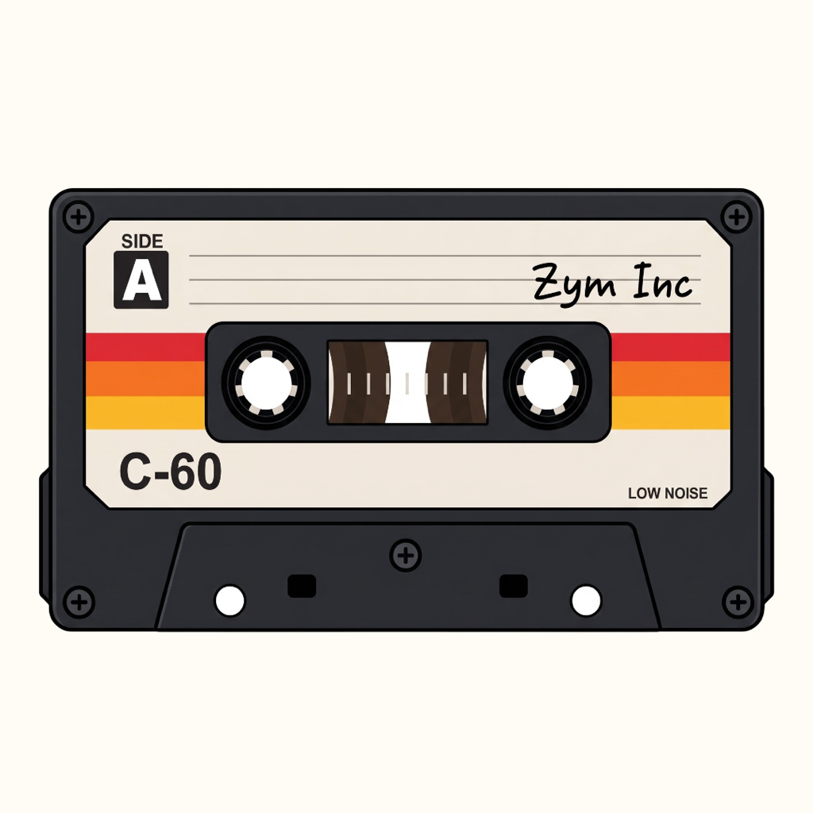

<p align="center">
  
</p>

<h1 align="center">Cassette</h1>
<p align="center"><strong>Your music. Your pocket.</strong><br>A native offline music player for iPod touch, with a Mac Catalyst companion.</p>

<p align="center">
  <a href="docs/build/ipod-installation.md">Get started</a> ·
  <a href="docs/build/build-artifacts.md">Build for iPod</a> ·
  <a href="docs/build/mac-export.md">Build for Mac</a> ·
  <a href="docs/product/changelog.md">Changelog</a>
</p>

[](https://github.com/sagnikb7/casette/actions/workflows/ci.yml)
[](docs/product/changelog.md)
[](docs/build/ipod-installation.md)
[](docs/build/mac-export.md)
[](docs/engineering/architecture.md)
[](docs/engineering/metadata-and-playlists.md)

Cassette puts your own music collection on an iPod touch (7th generation). Browse local folders, build playlists and listen offline through a native SwiftUI interface. Core Data preserves your library; AVFoundation handles playback. No account, streaming subscription or app analytics is required. Optional Wikimedia artist photos can be disabled in Settings.

## Features

| Your library | Your player |
|---|---|
| Songs, albums, artists, genres and folders with right-aligned counts | Artwork-backed Now Playing with a fixed control dock |
| Folder scanning, file import and live rescan progress | Larger seek handle, hold-to-seek Next/Previous and artwork double-tap |
| Favorites, editable playlists and M3U/M3U8 discovery | Queues, shuffle/repeat, local lyrics and timed LRC highlighting |
| Recently Played with ten song tiles and persistent full history | Playback-position restoration without automatic playback |
| Local artwork and optional cached artist photos | Square and horizontal iOS Home Screen widgets |

## A look inside

<p align="center">
  
  
  
</p>

These are native UIKit/Catalyst captures at 320-point width using isolated test fixtures. They show the implemented layout; physical iPod interaction and performance still need device verification. Test music is never included in the app.

## Start listening

1. Open **Cassette** and tap **Add Music Folder**. Choose a downloaded local folder through Files → Browse → On My iPod. Cassette remembers access and scans its contents.
2. Alternatively, use **Import Audio Files** to copy audio into the app. On a trusted Mac, Finder → iPod → Files → Cassette also accepts audio transfers.
3. Browse your collection and tap a song. Open the mini-player for Now Playing; double-tap artwork to play/pause, drag the seek handle or hold Next/Previous to seek.
4. Open **Recently Played** to revisit your last ten plays; its header chevron opens the full listening history.
5. Use **Settings → Music Folders** to rescan, reconnect, disable a source or exclude subfolders. Removing a source never deletes your original audio.

Album art and lyrics remain local. Artist photos are the optional network exception: artist names are sent to Wikipedia/Wikimedia, and credited images are cached offline. See the [metadata and playlist policy](docs/engineering/metadata-and-playlists.md).

## How media sync works

Cassette keeps a local index of your files. “Sync” means discovering and indexing local music; there is no account, cloud music sync, or upload of your audio.

| Action | What Cassette does |
|---|---|
| Launch the app | Shows the saved library immediately. Checks timestamps/identities of known directories in Cassette’s own folder; does not enumerate songs when unchanged. |
| First scan or missing checkpoint after upgrade | Builds a checkpoint with one full local scan. Later unchanged launches skip that scan. |
| Unlock or return to the app | No new folder check or scan. A previously deferred automatic scan may resume when idle. |
| Import Audio Files | Copies files into Cassette, then scans only its owned source. |
| Add/reconnect/enable a folder, or change exclusions | Scans the affected enabled source. These explicit actions may scan during playback. |
| A known local directory changed before launch | Scans the owned source once, reusing unchanged song metadata. Changes include file additions/removals/renames and newly created subfolders. |
| Playback starts or app backgrounds | Cancels automatic scan work and defers it. It can resume when foregrounded and playback stops. User-cancelled work does not restart automatically. |
| Edit existing tags/lyrics, change provider-folder files, or transfer through Files/Finder during a session | Use **Settings → Rescan Library**, or a source’s **Rescan**. No live watcher, periodic polling or provider crawl is used. |

Directory checks cost one metadata lookup per known folder, not one per song. A library with 500 songs inside one album folder needs two directory checks (Cassette plus the album) on an unchanged launch. A changed source still requires enumeration to identify its changes, but unchanged songs skip metadata reads and database merge batches; progress is throttled and artwork is downsampled.

Folder timestamps do not reliably reveal edits inside existing audio or lyric files, and providers may not expose reliable timestamps. Those changes require manual rescan. A checkpoint is saved only after a complete, successful scan; cancellation retains the prior checkpoint and saved library. Missing tracks are marked unavailable only after complete enumeration. Source removal never deletes audio.

Favorites, playlists, history and playback state remain in the private database. Widgets receive only last-played title, artist and a bounded cover through a shared App Group; they never scan your music. See [architecture](docs/engineering/architecture.md) and [metadata and playlists](docs/engineering/metadata-and-playlists.md).

## Recent reliability fixes

- Replaced recurring full startup scans with saved directory checks; unchanged launches skip audio scanning, and automatic scans wait during playback. Reduced scan UI/database work and artwork memory pressure.
- Hardened file access during locked playback and audio-session transitions; permission error −54 now includes recovery steps. The reported physical iPod termination still needs device verification.
- Added a queue-aware sleep timer in Now Playing: timed presets, End of Song and End of Queue. Presets longer than a finite queue's remaining duration are disabled; repeat permits longer timed sessions.
- Consolidated duplicate Settings links and playback preferences.
- Replaced the app icon and widget marks with the designer’s retro rainbow cassette; the supplied original is preserved in the design assets.
- Added widget recovery on launch, **Settings → Widgets → Refresh Widgets**, shared-storage status, a periodic timeline retry and bounded artwork decoding. Both sizes retain a visible Cassette fallback if song data or artwork is unavailable. iOS controls refresh timing.

For a black widget, unlock and launch Cassette, open **Settings → Widgets**, then tap **Refresh Widgets**. If it remains black, remove and re-add the Home Screen widget. If shared storage is unavailable, the app and extension need matching provisioned App Groups; an app preview cannot verify extension signing or Home Screen execution. See [widget recovery and verification](docs/testing/verification/widget-recovery-qa.md). These changes address identified failure paths; the reported black widgets still require an on-device retest.

## Build

Requires macOS and full Xcode. Open `OfflineMusicPlayer.xcodeproj` and use the **OfflineMusicPlayer** scheme, or run the launcher from the repository root:

```sh
# iPod: Release arm64, iOS 15+, unsigned IPA
./build --platform=ipod

# Mac: universal Mac Catalyst, macOS 12+, ad-hoc signed Cassette.app
./build --platform=mac
```

Plain `./build`, “build” or “create build” defaults to iPod. Codex also recognizes `build --platform=ipod` and `build --platform=mac`. Both use `scripts/create_build.sh`; `./build --help` lists the options. This preference is saved in [AGENTS.md](AGENTS.md).

| Platform | Generated artifacts | Last verified export |
|---|---|---|
| iPod | `dist/Cassette-unsigned-<version>.ipa` | **1.5.3 (18)** |
| Mac | `dist/Cassette.app` | **1.5.3 (18)** |

The launcher validates architecture, platform, minimum OS, embedded resources, versions and archive integrity before finalizing release notes. Builds run sequentially under a lock. Exporting the other platform from unchanged sources reuses the version/build; rebuilding an already-exported platform increments the build number. Failed retries do not consume versions. Packages stay outside Git.

**Installation:** iPod artifacts require signing/provisioning, including matching widget App Groups. Mac artifacts are ad-hoc signed for local use and are not notarized for public distribution. Desktop widgets are absent; previews are available in Settings. See [iPod installation](docs/build/ipod-installation.md), [Mac export](docs/build/mac-export.md) and the [latest build receipt](docs/testing/verification/final-build.md).

## Verify

```sh
# Release tooling and repository/documentation consistency
python3 -m unittest discover -s scripts/tests -v
python3 scripts/verify_repository.py

# Native Release regression suite
xcodebuild -project OfflineMusicPlayer.xcodeproj -scheme OfflineMusicPlayer \
  -configuration Release -destination 'platform=macOS,variant=Mac Catalyst' \
  -derivedDataPath /tmp/CassetteTests \
  ENABLE_TESTABILITY=YES ENABLE_HARDENED_RUNTIME=NO \
  CODE_SIGN_IDENTITY=- CODE_SIGN_STYLE=Manual test
```

The current pre-push suite passed **53 native tests** and **18 workflow tests**, including 500-file scan reuse, incomplete-scan preservation, sleep-timer behavior and widget recovery. [Testing](docs/testing/testing.md) records the commands, results and remaining device checks. The CI badge links to [Cassette QA](docs/build/continuous-integration.md); hosted CI status is independent of local results.

## Documentation

| Topic | Guides |
|---|---|
| Product | [Specification](docs/product/offline-music-player-spec.md) · [Library reliability and sleep timer](docs/product/library-reliability-and-sleep-timer.md) · [Decisions](docs/product/product-decisions.md) · [Roadmap](docs/product/roadmap.md) · [Changelog](docs/product/changelog.md) |
| Engineering | [Architecture](docs/engineering/architecture.md) · [Implementation plan](docs/engineering/implementation-plan.md) · [Metadata and playlists](docs/engineering/metadata-and-playlists.md) |
| Design | [Prototype mapping](docs/design/prototype-mapping.md) · [Cassette widgets and branding](docs/design/cassette-widgets.md) · [Native UI QA](docs/design/native-ui-qa.md) |
| Build | [Artifacts](docs/build/build-artifacts.md) · [Versioning](docs/build/versioning.md) · [iPod installation](docs/build/ipod-installation.md) · [Mac export](docs/build/mac-export.md) · [CI](docs/build/continuous-integration.md) |
| Quality | [Testing](docs/testing/testing.md) · [Repository audit](docs/testing/repository-audit.md) · [Codec evidence](docs/testing/codec-support.md) · [Player/folder QA](docs/testing/verification/player-folder-qa.md) · [Feature-expansion QA](docs/testing/verification/feature-expansion-qa.md) · [Latest build](docs/testing/verification/final-build.md) |

## Project layout

```text
OfflineMusicPlayer.xcodeproj/       Xcode project and shared scheme
OfflineMusicPlayer/                SwiftUI app, library, playback, metadata and widgets
CassetteWidget/                    iOS WidgetKit extension and App Group configuration
OfflineMusicPlayerTests/            Isolated tests and test-only audio fixtures
scripts/                           Build, packaging, release and verification tools
release/                           Version manifest and pending release notes
docs/                              Product, engineering, design, build and QA guides
offline-music-player-prototype/     Original user-supplied design references
dist/                              Generated artifacts; ignored by Git
```

## Status and identity

Current-facing documentation and assets use **Cassette**. Older release entries, original design references and archived test records retain their historical names. Internal target names, bundle identity and persistence paths remain stable so updates preserve music access, playlists and favorites. The repository spelling is intentionally [sagnikb7/casette](https://github.com/sagnikb7/casette).

Physical iPod signing/installation, provider-folder journeys, accessibility, background playback, A10 performance and per-codec certification remain open. Queue reordering and deeper codec-specific metadata parsing are tracked in the [implementation plan](docs/engineering/implementation-plan.md). Candidate file extensions are not a verified codec guarantee; consult [codec evidence](docs/testing/codec-support.md).

Builds produce no ZIP companions. Quit Cassette on Mac, then drag `Cassette.app` into Applications and choose Replace to update. The version remains inside the app. If you installed an older version-named app, remove that old application bundle once to avoid duplicate installations; keep your music and application data.
